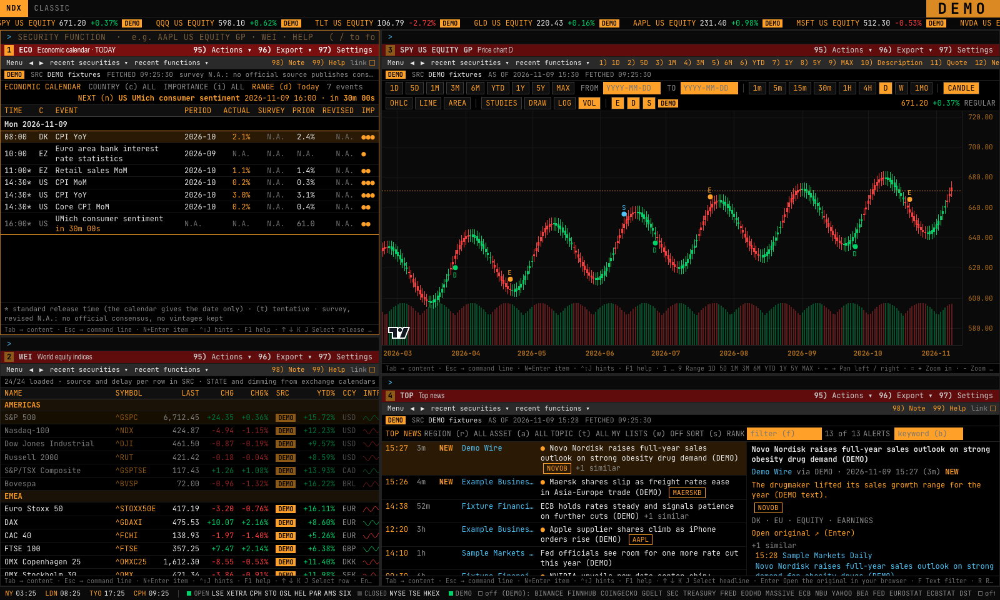
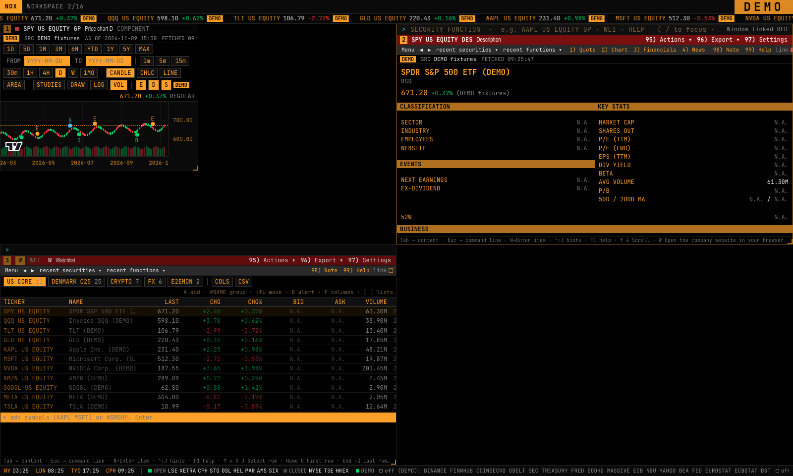
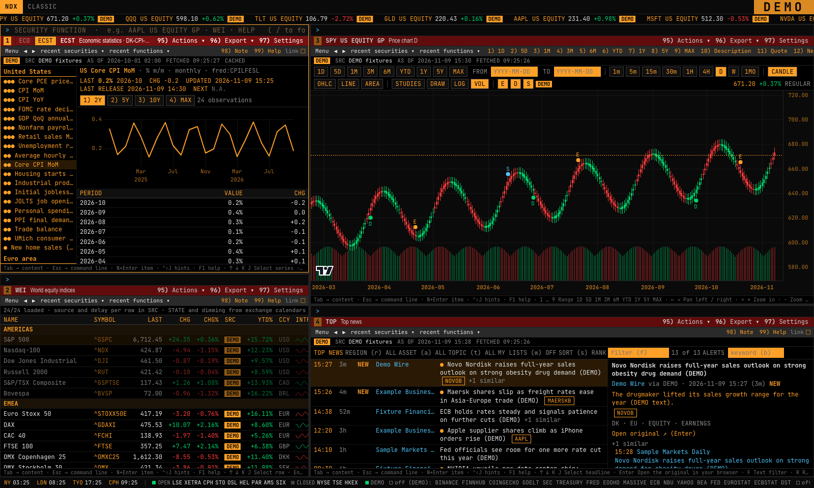
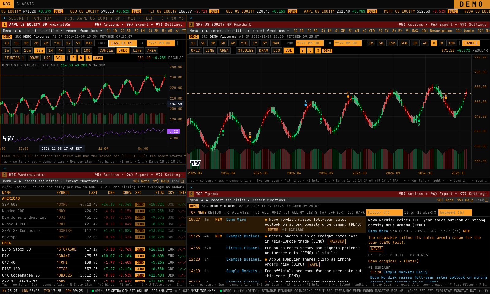
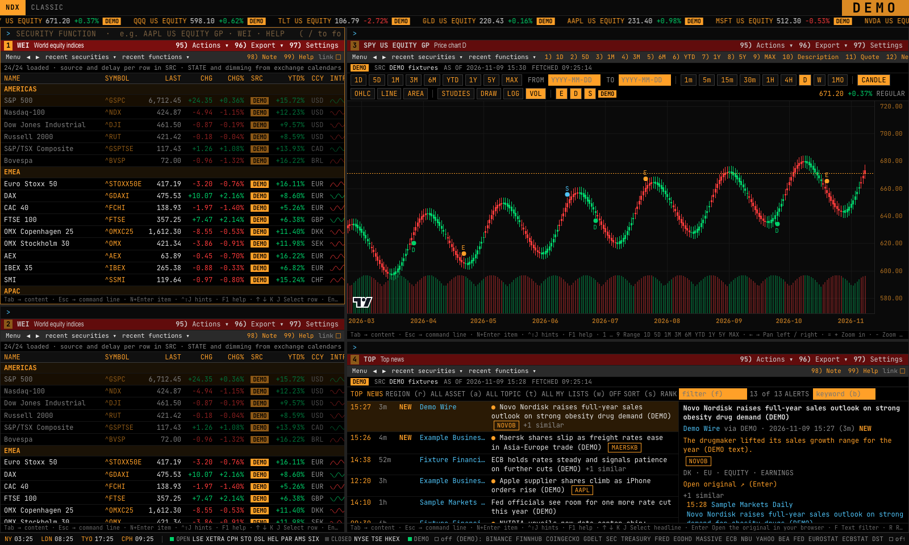
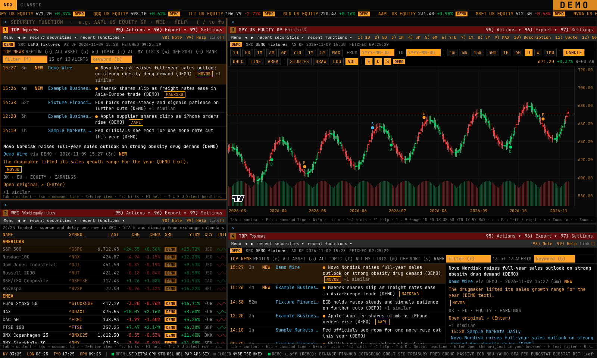
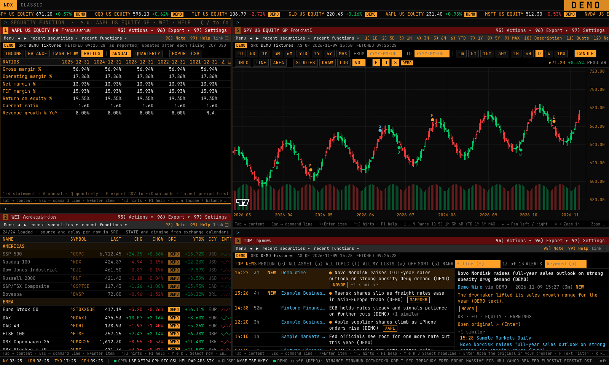
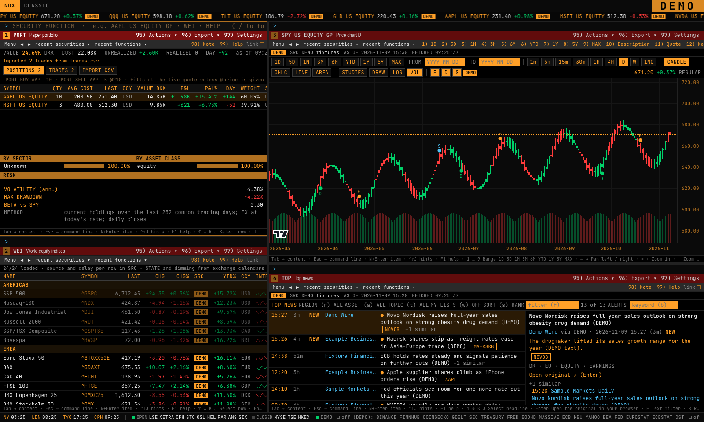
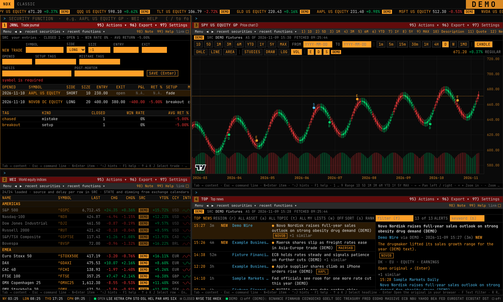

# NDX Terminal

A keyboard-first desktop market terminal for macOS (Apple Silicon), built only on **free and
official data sources**. Tiled panels and tabs, a command line with short function codes
(`AAPL GP`, `ECO US HIGH`, `NOVOB DC DES`), live quotes, research, macro calendars and a few
personal tools. Every value carries its source and a freshness tag (`RT`, `DELAYED 15m`, `EOD`,
`CACHE hh:mm`, `STALE`); when no source covers something the app shows `N.A.` instead of a
guess.



`ECO` (official release calendars, next-release countdown, survey `N.A.`), `GP`, `WEI` and `TOP`
in the classic tiled layout.

> **Disclaimer.** NDX Terminal is an independent personal project. It is **not affiliated with,
> endorsed by or connected to Bloomberg L.P.** or any other terminal or data vendor. Nothing it
> shows is **investment advice**; data can be delayed, incomplete or wrong — check the source.

## Screenshots

| | |
| --- | --- |
|  Workspace mode: free windows, linked by colour |  `ECST` — the official series behind an ECO line |
|  `GP` — chart with indicators and events |  `WEI` — world indices, each row with its own source and delay |
|  `TOP` — ranked news with near-duplicate clusters |  `FA` — statements and ratios, latest period first |
|  `PORT` — paper portfolio, CSV import |  `JRNL` — trade journal with stats by tag |

All screenshots are from DEMO mode: deterministic synthetic fixtures, marked with a `DEMO` badge,
produced by the Playwright E2E run (`make evidence`). No real market data is shown.

## What it does

| Area | Functions |
| --- | --- |
| Market | `GP` chart · `Q` quote · `MON` monitors/watchlists · `WEI` world indices · `WFX` FX · `GLCO` commodities · `CRYPTO` · `HP` price history · `GIP` intraday · `CDR` market calendar |
| Research | `DES` description · `FA` financial statements · `TOP` / `N` / `CN` news · `EQS` screener · `CF` filings · `INS` insiders · `CORR` correlations |
| Macro | `ECO` economic calendar · `ECST` economic series · `YC` US yield curve |
| Tools | `PORT` paper portfolio (manual or CSV) · `ALRT` price alerts · `JRNL` trade journal · `NOTE` notes · `BT` backtests |
| System | `HELP` · `SRCH` · `MENU` · `KEYS` · `LAYOUT` · `LINK` · `PDF` settings · `PROV` providers · `FLDS` · `LOG` |

Syntax, keys and sources per function: [docs/FUNCTIONS.md](docs/FUNCTIONS.md). Functions from
the spec that were not built are listed there too; typing one says "not built in this version".

Interaction: `/` or `Esc` opens the command line, autocomplete on every token, `Enter` runs in
the active panel, `⇧Enter` in a new one; panels split, maximize, link by color group and save as
named layouts; every panel has its own hotkeys (`?` shows them).

## Stack

| Layer | Tech |
| --- | --- |
| Desktop shell | Tauri 2 (Rust) — window, native notifications, starts the data service as a sidecar on `127.0.0.1` with a per-launch token |
| UI | React 19 + TypeScript, Vite, TanStack Query, uPlot / lightweight-charts, Zustand; Vitest + Playwright |
| Data service | Python 3.12, FastAPI, httpx, Pydantic v2, SQLite (user data), DuckDB (bar cache); uv; pytest, ruff, mypy |
| Contract | OpenAPI generated from the Pydantic models → TypeScript types in `shared/` (drift checked in CI) |
| Packaging | PyInstaller (`--onedir`) for the service inside the `.app` bundle |

The data service has a provider router: each capability (quotes, bars, fundamentals, economic
calendar…) has an ordered list of providers with token-bucket budgets, TTL caches, fallbacks
(shown as `FALLBACK a → b`) and a health status (`PROV`).

## Data sources and their terms

All sources are free tiers or official public data. **Bring your own keys:** every key is
optional, belongs to you and stays on your machine (`.env` or the macOS Keychain); the app never
logs it and `PROV` only shows whether it is set. Without a key the matching rows show `N.A.` or
fall back to another source.

| Data | Sources |
| --- | --- |
| US stocks — live | Finnhub WebSocket (trades), Tiingo (secondary) |
| US bars history | Massive (formerly Polygon.io) basic tier |
| EU/Nordic stocks, indices | EODHD free plan (EOD); opt-in yfinance, off by default |
| Crypto | Binance, Coinbase (live); CoinGecko (market caps) |
| FX | ECB reference rates; National Bank of Ukraine (UAH) |
| Rates | U.S. Treasury par yield curve |
| Economic calendar & series | BEA, Federal Reserve, FRED release dates (BLS/Census), Eurostat, ECB, Statistics Denmark |
| Fundamentals, filings | SEC EDGAR (XBRL companyfacts, submissions) |
| News | Finnhub, GDELT, RSS feeds you add yourself |

**Terms.** The app is built for **personal, single-user, non-commercial use**. Each provider's
terms apply to the data you fetch with your key: do not redistribute it, publish it or use it
commercially unless that provider allows it. Some sources are marked `PERSONAL USE` in the app
(e.g. the opt-in yfinance source, which reads Yahoo Finance data). Required notices (FRED, SEC,
ECB…) are in `HELP SOURCES`. Limits, terms and links per provider, as checked in November 2026:
[docs/PROVIDERS.md](docs/PROVIDERS.md). This repository contains no market data: DEMO fixtures
and test fixtures are synthetic.

## Honest limitations

- **No consensus forecasts.** No official source publishes them, so `ECO` survey and revised
  columns are always `N.A.`; earnings surprise is `N.A.`.
- **Coverage gaps.** Economic calendars cover the US, euro area and Denmark only (Germany, UK,
  Japan, China show an explicit `N.A.` line). Financial statements come from SEC EDGAR (US
  filers and foreign 20-F/40-F filers); others need the opt-in yfinance source.
- **Delays.** Free tiers mean delayed or end-of-day data for most non-US and non-crypto
  instruments; there is no consolidated US bid/ask (`N.A.`). Every value says how fresh it is.
- **Simple versions.** `DES`, `FA`, `PORT`, `ALRT` and `JRNL` are deliberately simple (see
  [docs/FUNCTIONS.md](docs/FUNCTIONS.md)); about half of the spec's ~70 functions were not built
  (options, index members, relative value, heat maps, tear-off windows…).
- **Alerts** run only while the app is running. The portfolio is a paper portfolio (no broker).
- **macOS on Apple Silicon only**; the bundle is ad-hoc signed (not notarized).
- **Not investment advice**, not for redistribution of data.

## Run it

Requirements: macOS 14+, Apple Silicon, Xcode Command Line Tools, Homebrew.

```bash
scripts/setup.sh
```

Installs Node, pnpm, uv, Rust, Python 3.12 and all dependencies, and creates `.env` from
`.env.example`. Then:

```bash
make dev DEMO=1
```

starts the data service and the app with DEMO fixtures (no keys, no network). Without `DEMO=1`
it uses real sources; `WEB=1` runs the UI in a browser at <http://localhost:1420>.

Optional keys go in `.env` (development) or `~/Library/Application Support/NDX Terminal/.env`
(the built app): `FINNHUB_API_KEY`, `TIINGO_API_KEY`, `MASSIVE_API_KEY`, `EODHD_API_KEY`,
`ALPHAVANTAGE_API_KEY`, `FRED_API_KEY`, `COINGECKO_API_KEY`, and `EDGAR_USER_AGENT` (SEC asks
for a descriptive User-Agent with your contact). Keys are never logged; `PROV` shows only
whether each one is set.

## Checks and build

```bash
make check
```

No-fake-data scan, OpenAPI/TypeScript drift, server (ruff, format, mypy, pytest), app (eslint,
typecheck, vitest), Playwright E2E with a perf smoke on a DEMO backend.

Recorded provider responses are not in this repository (provider terms), so the server tests that
parse them are **skipped** — 65 of 501, e.g. the Yahoo, SEC, Binance and release-calendar
parsers; the rest pass. [server/tests/fixtures/README.md](server/tests/fixtures/README.md) lists
them and shows how to record your own copies to run them.

```bash
make build
```

Builds `NDX Terminal.app` and a `.dmg` under `app/src-tauri/target/release/bundle/`. Data lives
in `~/Library/Application Support/NDX Terminal/`, logs in `~/Library/Logs/NDX Terminal/`.

## Repository

```
app/       Tauri 2 shell (src-tauri/) + React/TypeScript UI (src/)
server/    FastAPI data service: providers, router, cache, live hub, alerts, analytics
shared/    OpenAPI schema + generated TypeScript types
scripts/   setup, dev, build, type generation, no-fake-data scan
docs/      FUNCTIONS.md (every function), PROVIDERS.md (sources, limits, terms), screenshots/
```

The product name is one config value in [`brand.json`](brand.json).

## License

[MIT](LICENSE).
